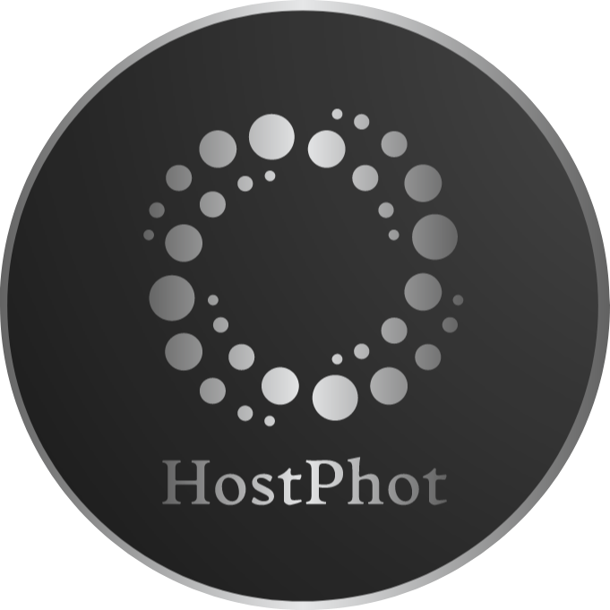

<p align="center"></p>

Global and local photometry of galaxies hosting supernovae or other transients

[](https://github.com/temuller/hostphot)
[](https://hostphot.readthedocs.io/en/latest/?badge=latest)
[](https://github.com/temuller/hostphot/blob/master/LICENSE)
[](https://github.com/temuller/hostphot/actions/workflows/main.yml)

[](https://pypi.org/project/hostphot/)
[](https://doi.org/10.21105/joss.04508)
[](https://doi.org/10.5281/zenodo.6992139)
[](https://github.com/temuller/hostphot/tree/python-coverage-comment-action-data)

Read the full documentation at [hostphot.readthedocs.io](https://hostphot.readthedocs.io/en/latest/). It is recommended to read the **Further Information** section to understand how HostPhot works.
___

## Conda environment

It is recommended to create an environment before installing HostPhot:

```code
conda create -n hostphot pip
conda activate hostphot
pip install hostphot
```

### Requirements

HostPhot requirements can be found in the `requirements.txt` file.

### Tests

To run the tests, go to the parent directory and run the following command:

```code
pytest -v
```

## Modules

### Cutouts

This module allows you to download image cutouts from different surveys (e.g. `PanSTARRS`):

```python
from hostphot.cutouts import download_images

name = 'SN2004eo'
host_ra, host_dec = 308.2092, 9.92755  # coords of host galaxy of SN2004eo
survey = 'PanSTARRS'
download_images(name, host_ra, host_dec, survey=survey)
```

### Image Pre-processing

Coadds can be created and stars can be masked out of the images:

```python
from hostphot.coadd import coadd_images

coadd_filters = 'riz'
coadd_images(name, filters=coadd_filters, survey=survey)  # creates a new fits file
```

```python
from hostphot.processing.masking import create_mask

# one can extract the mask parameters from the coadd
# this also creates new fits files
coadd_mask_params = create_mask(name, host_ra, host_dec,
                                filt=coadd_filters, survey=survey,
                                extract_params=True)  

for filt in 'grizy':
    create_mask(name, host_ra, host_dec, filt, survey=survey,
                common_params=coadd_mask_params)
```

If the user is not happy with the result of the masking, there are a few parameters that can be adjusted. For instance, `threshold` sets the threshold used by `sep` for detecting objects. Lowering it will allow the detection of fainter objects. `sigma` is the width of the gaussian used for convolving the image and masking the detected objects. If `crossmatch` is set to `True`, the detected objects are cross-matched with the stars of Gaia DR3 (those with significant proper motion or parallax, as Gaia also detects compact regions of nearby galaxies) and only those in common are masked. This is useful for very nearby host galaxies (e.g. that of SN 2011fe) so the structures of the galaxy are not maked out, artificially lowering its flux.

### Local Photometry

Local photometry can be obtained for multiple circular apertures:

```python
import hostphot.photometry.local_photometry as lp

ap_radii = [3, 4]  # aperture radii in units of kpc
ra, dec =  308.22579, 9.92853 # coords of SN2004eo
z = 0.0157  # redshift

results = lp.multi_band_phot(name, ra, dec, z,
                             survey=survey, ap_radii=ap_radii, 
                             use_mask=True, correct_extinction=True,
                             save_plots=True)
```

If the results return `NaN` values, this means that the flux is below the detection limit for the given survey.

### Global Photometry

Global photometry can be obtained in a similar way to local photometry, using common aperture:

```python
import hostphot.photometry.global_photometry as gp

results = gp.multi_band_phot(name, host_ra, host_dec, 
                             survey=survey, ra=ra, dec=dec,
                             use_mask=True, correct_extinction=True,
                             common_aperture=True, ref_filt='riz', 
                             save_plots=True)
```

With `correct_extinction=True`, HostPhot corrects for Milky Way extinction using the recalibrated dust maps
by Schlafly & Finkbeiner (2011) and the extinction law from Fitzpatrick (1999). The correction is not applied by default.

### Surveys List

This is the list of surveys in HostPhot:

* DES
* PanSTARRS
* SDSS
* GALEX
* 2MASS
* WISE
* unWISE
* Legacy Survey
* Spitzer (SEIP)
* VISTA (VHS, VIDEO, VIKING)
* HST (WFC3, ACS/WFC and NICMOS)
* SkyMapper (not well calibrated for extended sources)
* SPLUS
* UKIDSS
* JWST (NIRCam only)
* Herschel (PACS, SPIRE)
* HSC (Hyper Suprime-Cam SSP PDR3; requires login credentials — see [hsc-release.mtk.nao.ac.jp](https://hsc-release.mtk.nao.ac.jp/datasearch/))

#### HSC credentials

HSC-SSP data are only available to registered users ([create an account here](https://hsc-release.mtk.nao.ac.jp/datasearch/new_user/new)). HostPhot reads your username and password from the `HSC_SSP_USERNAME` and `HSC_SSP_PASSWORD` environment variables. The easiest way to set them is to add them to a `.env` file in the directory from which you run your code (or any parent directory), which HostPhot loads automatically:

```
HSC_SSP_USERNAME=your_username
HSC_SSP_PASSWORD=your_password
```

Do not commit this file to a public repository (add it to your `.gitignore`).

## Contributing

To contribute, either open an issue or send a pull request (prefered option). You can also contact me directly (check my profile: [https://github.com/temuller](https://github.com/temuller)).

### Adding other surveys

If you wish a survey to be added to HostPhot, there are a couple of ways of doing it. 1) You can do a pull request, following the same structure as used for the surveys that are already implemented, or 2) open an issue asking for a survey to be added. Either way, there are a fews things needed to add a survey: where to download the images from (e.g., using `astroquery`), zero-points to convert the images's flux/counts values into magnitudes, the magnitude system (e.g. AB, Vega), the pixel scaling of the images (in units of arcsec/pixel), the filters transmission functions and any other piece of information necessary to properly estimate magnitudes, errors, etc. If you open an issue asking for a survey to be added, please include all this information. For more information, please check the [Adding New Surveys](https://hostphot.readthedocs.io/en/latest/further_information/adding_surveys.html) section of the documentation.

## Citing HostPhot

If you make use of HostPhot, please cite the following [paper](https://joss.theoj.org/papers/10.21105/joss.04508):

```code
@article{Müller-Bravo2022, 
  author = {Tomás E. Müller-Bravo and Lluís Galbany},
  title = {HostPhot: global and local photometry of galaxies hosting supernovae or other transients},
  doi = {10.21105/joss.04508}, 
  url = {https://doi.org/10.21105/joss.04508}, 
  year = {2022}, 
  publisher = {The Open Journal}, 
  volume = {7}, 
  number = {76}, 
  pages = {4508},  
  journal = {Journal of Open Source Software} 
} 
```

## What's new

See the [changelog](https://github.com/temuller/hostphot/blob/main/CHANGELOG.md) for the changes in each version.

## Acknowledgements

I thank Yuchen LIU for helping me adding Spitzer as part of AstroHackWeek 2022. I also thank Lisa Kelsay for helping add HST and JWST.

The update to version 4.0.0 (validation against the survey catalogues, fixes to the photometric uncertainties, background estimation and downloads, and new tests) was carried out with the assistance of Claude (Anthropic), via Claude Code.
